<p align="center">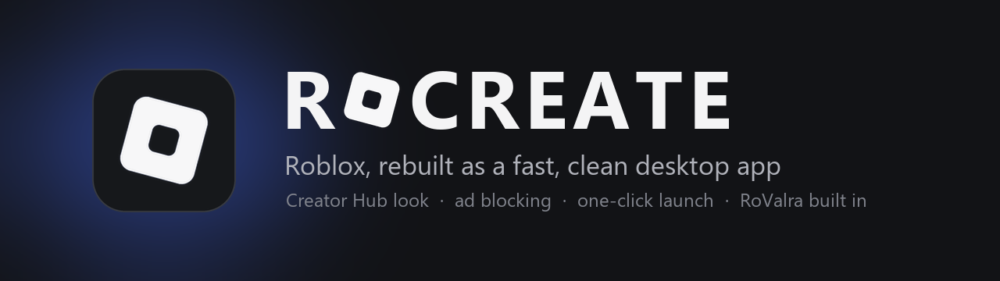</p>

<p align="center">
  <a href="https://rocreate.org"></a>
  <a href="https://rocreate.org/download.html"></a>
  
  
  <a href="LICENSE"></a>
</p>

RoCreate is a free Chrome extension. It gives roblox.com a clean, flat Creator Hub look and adds
the numbers creators care about: game revenue, your Robux, inventory value and more. It runs
entirely in your browser, works alongside [RoValra](https://github.com/NotValra/RoValra), and
every part can be switched off.

**[Download it at rocreate.org](https://rocreate.org/download.html)**: take the full bundle, or
pick exactly which features and services you want. See what's new in the [changelog](https://rocreate.org/changelog.html).

<p align="center">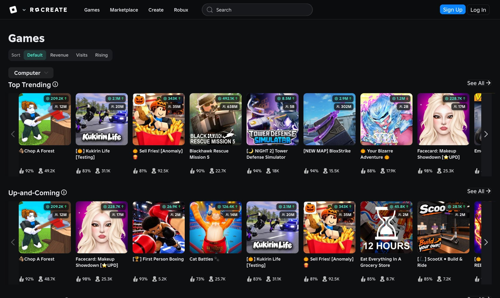</p>

## Features

**Game stats on every card.** Estimated revenue with a trend arrow, and total visits. Point at
them for the exact numbers and a 7-day player graph, and sort the Games page by revenue, visits
or what's rising. Data from [Creator Exchange](https://creatorexchange.io).

<p align="center">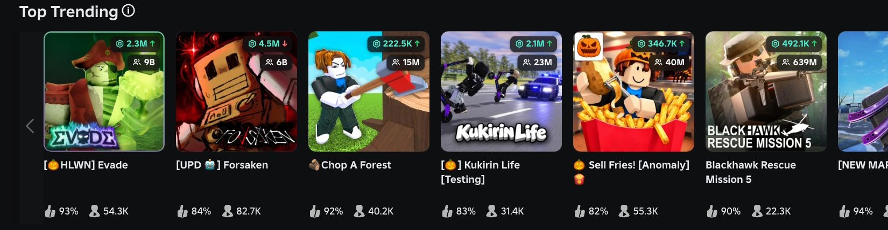</p>

**A stats strip on game pages.** Estimated revenue, players and visits with this week's change,
rating, favorites, global rank and average session time. Press Watch to follow a game from the
toolbar popup.

<p align="center">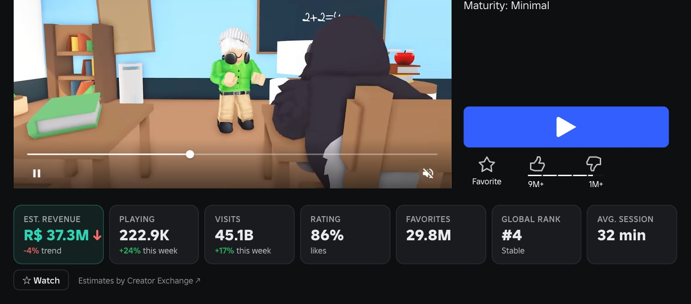</p>

**Profile insights.** One tidy section with tabs: account age and last seen, inventory value and
its history (from [Rolimons](https://www.rolimons.com)), every official Roblox item the account
owns with prices and price filters, mutual friends and previous usernames.

| | |
|---|---|
| 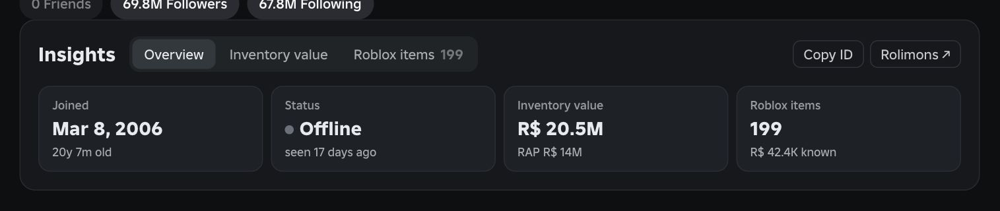 | 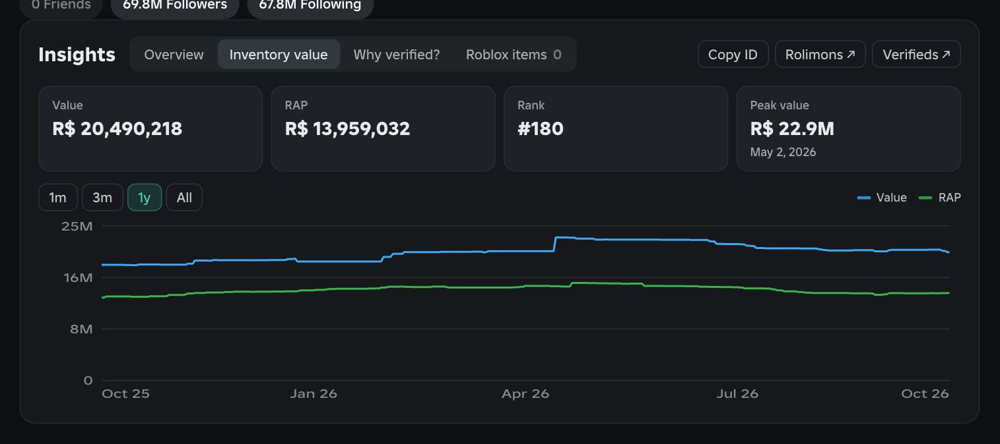 |
| Overview | Inventory value |

<p align="center">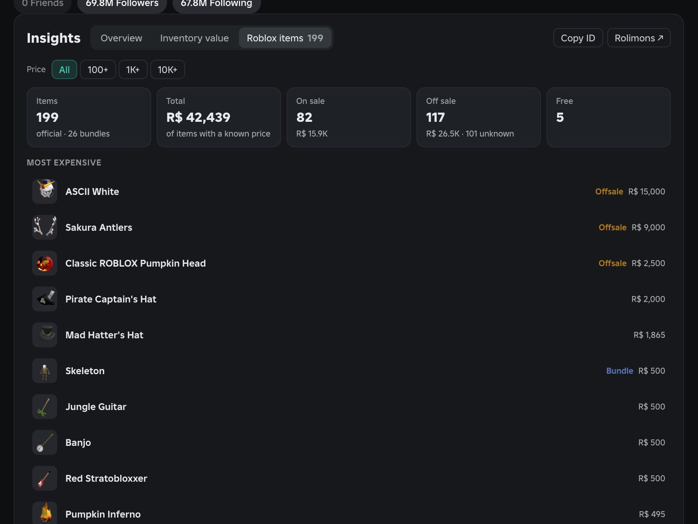</p>

**Your Robux, in full.** The Robux menu shows your pending Robux and the funds of every group
you manage. *(Example data.)*

<p align="center">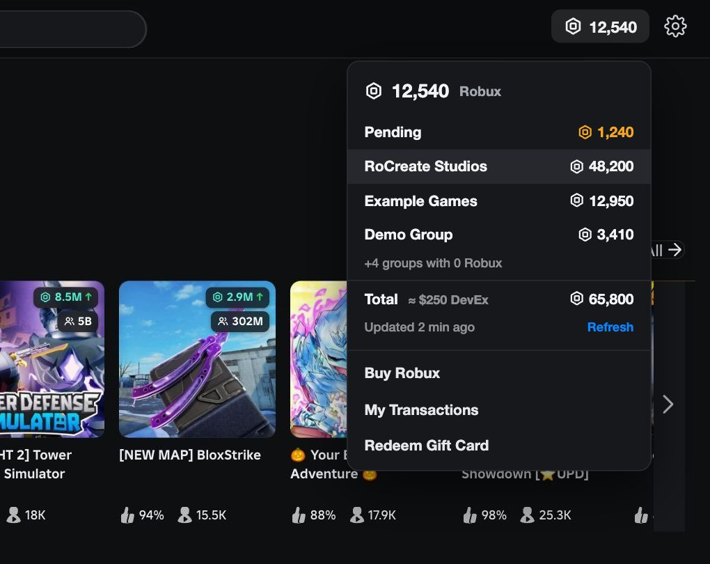</p>

**Know who you're dealing with.** Real Roblox staff get the Roblox logo next to their name.
Optionally, accounts flagged on RobloxVerifieds, or that lost their verified badge, get a red
badge with an X. *(Example names, except builderman.)*

<p align="center">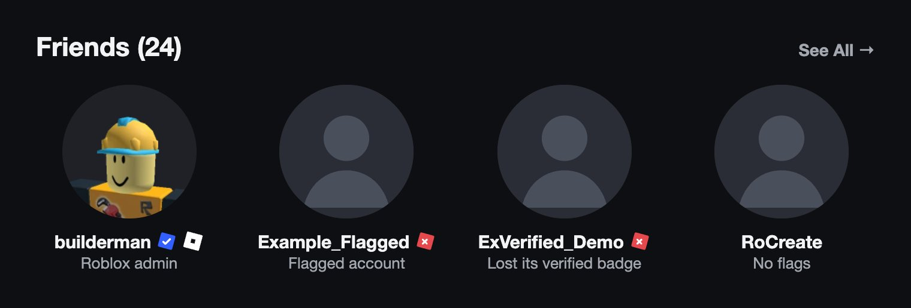</p>

**And more:**

- **Watchlist:** press Watch on a game page and follow it from the toolbar popup.
- **Clean and fast:** a flat, dark style for the whole site, with ads and upsells hidden.

## Install

The Chrome Web Store listing is on its way. Until then:

1. Get a ZIP from the [download page](https://rocreate.org/download.html) and unzip it. Keep the
   folder, because Chrome loads the extension from it.
2. Open `chrome://extensions` and turn on **Developer mode**.
3. Click **Load unpacked** and pick the **RoCreate** folder.

To update, download again and unzip over the same folder. RoCreate notices the new version and
reloads itself within a minute.

**From source:** clone this repo and load `extensions/theme` the same way. It includes every
feature.

## Privacy

RoCreate has no server, account or tracking. It calls Roblox's own APIs with the login you
already have in your browser, plus only these services, for the features that need them:
Creator Exchange, Rolimons and RobloxVerifieds. A copy built on the download page includes only
the services of the features you picked. Full details:
[rocreate.org/privacy](https://rocreate.org/privacy.html).

## How it works

- **The theme** redefines Roblox's own design tokens (the Foundation CSS variables), plus rules
  for the older top bar, so the unstyled site never flashes.
- **Content scripts** add the stats, badges, menus and profile section. A **background worker**
  talks to the outside services and caches what they return, so pages stay fast.
- **`config.json`** lists the features a copy includes. The download page builds the ZIP in your
  browser from this repo's files, leaves out the scripts and site permissions of anything
  unticked, and writes this file.

```
extensions/theme/      the Chrome extension
docs/                  the rocreate.org website (GitHub Pages)
app/, installer/       the desktop app (on hold)
extensions/redirect/   the desktop app's link-redirect extension
```

<details>
<summary><b>Desktop app (on hold)</b></summary>

RoCreate is Roblox as a desktop app. It wraps roblox.com in a lightweight window, restyles it
to look like the Creator Hub, blocks ads and trackers, launches games straight into the Roblox
player, and loads [RoValra](https://github.com/NotValra/RoValra) so you keep all of its features.
On Windows it uses the WebView2 runtime that already ships with Windows, so there is no bundled
browser. On macOS it runs on Qt WebEngine (Chromium), because Safari's web view can't load
Chrome extensions such as RoValra.

<p align="center">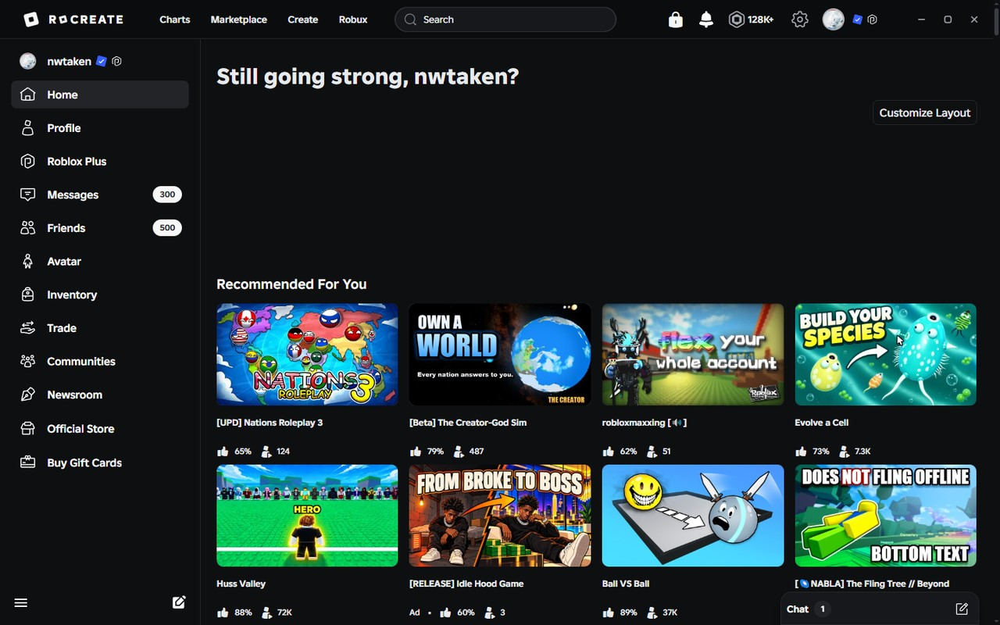</p>

### Download

**[Download RoCreate for Windows](https://github.com/nwtaken/RoCreate/releases/latest/download/RoCreate-Setup.exe)**,
then run the setup. It installs for your user only, so it doesn't need administrator rights.

> RoCreate isn't code-signed yet, so Windows SmartScreen may say it doesn't recognise the app
> the first time. Choose **More info → Run anyway**.

The setup wizard lets you pick what you want:

| Option | What it does |
|---|---|
| **RoCreate app** | The desktop app itself (required). |
| **Set up RoCreate with RoValra** | Downloads [RoValra](https://github.com/NotValra/RoValra) from the Chrome Web Store and loads it into the app. Kept up to date automatically. |
| **Include auto redirect?** | A small Chrome extension: every Roblox link you open in Chrome jumps straight into RoCreate instead. |
| **Include the RoCreate theme for Chrome?** | Optional. The same look on roblox.com inside Chrome. The app already has the theme built in. |
| **Block ads and trackers** | On by default. |
| **Shortcuts** | Desktop and Start menu. |

<p align="center">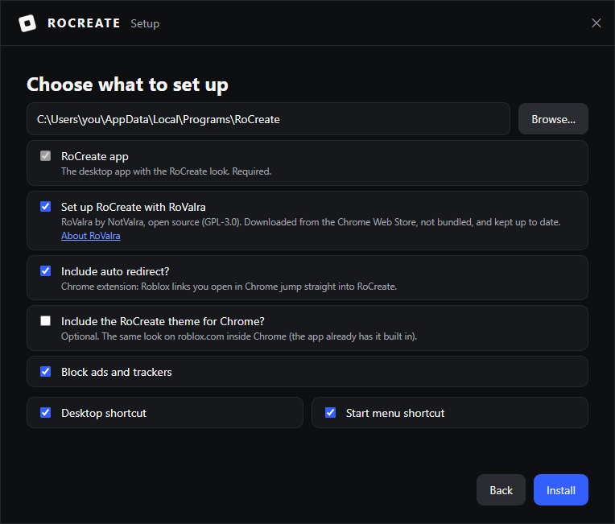</p>

Chrome only loads unpacked extensions in Developer mode, so the last page of the wizard opens
`chrome://extensions`, shows you each extension's folder, and ticks it off as soon as Chrome has
loaded it. You can bring that page back any time with `RoCreate.exe --chrome-setup`.

#### macOS

There's no Mac download yet. To build it, run `python installer/build.py` on a Mac: it makes
`dist/RoCreate.dmg`. Open it and drag **RoCreate** into **Applications**. RoValra is downloaded
the first time the app starts, and ad blocking is on.

> RoCreate isn't notarized yet, so macOS blocks it the first time. Open it once, then go to
> **System Settings → Privacy & Security** and click **Open Anyway**.

The Chrome extensions are in the DMG's **Chrome extensions** folder. Copy that folder somewhere
permanent (Chrome keeps loading from it), open `chrome://extensions`, turn on **Developer mode**,
click **Load unpacked** and pick `redirect` and/or `theme`. Roblox links opened in Chrome then go
straight to the app, the same as on Windows.

### What you get

<p align="center">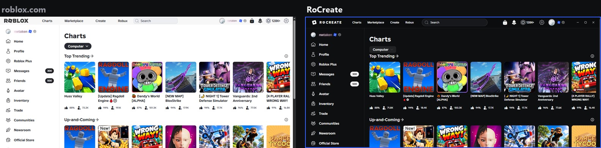</p>

- **The Creator Hub look.** Flat near-black surfaces, a rebuilt top bar, a gray pill for the
  active page, clean friend tiles with `@usernames`, tidy charts. RoValra's own interface picks
  up the same colours.
- **A greeting that knows the time.** The home title becomes things like *"Good morning,
  nwtaken!"* or *"Burning the midnight oil, nwtaken?"*: about 100 phrases for morning, afternoon,
  evening and night, using your display name (or your username if you have none).
- **Your Robux always visible** in the top bar, next to the icon.
- **Ad and tracker blocking** at the network layer. The list is a plain text file,
  [`app/blocklist.txt`](app/blocklist.txt), and nothing the site needs is on it.
- **One-click game launch.** Play goes straight into the Roblox player, no "open this link?"
  prompt.
- **RoValra, the real thing.** Not a copy of a few features: the actual extension, loaded into
  the app, so everything it does works.
- **Links open in the app.** With the redirect extension, a profile link or a private-server link
  opened in Chrome lands in RoCreate instantly; if the app isn't running it starts on that page.
- **Stays logged in**, with its own profile, so it never touches your browser's cookies.
- **Real window controls.** Frameless window with its own minimize / maximize / close, F11
  fullscreen, double-click the top edge to maximize, and thin dark scrollbars.

### Screenshots

| | |
|---|---|
| 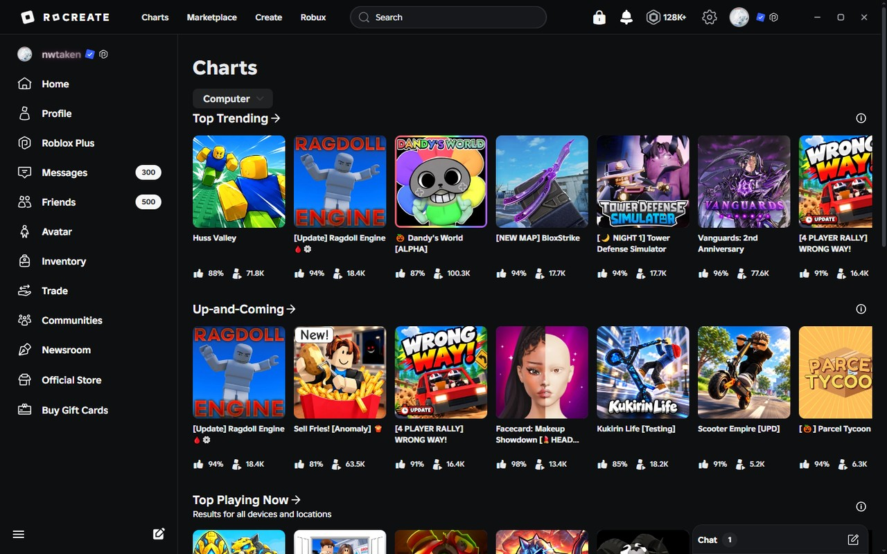 | 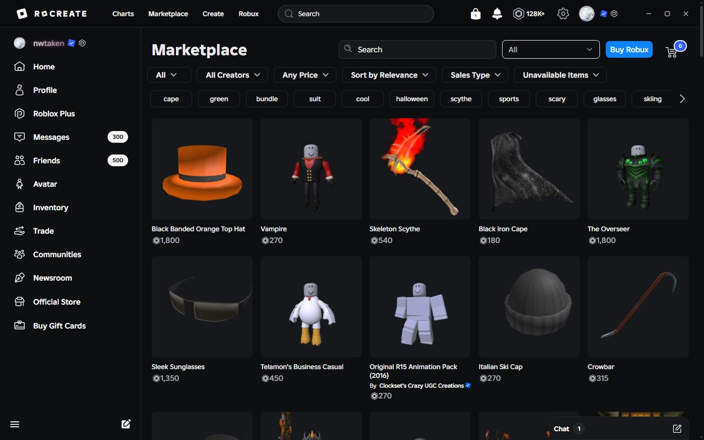 |
| Charts | Marketplace |
| 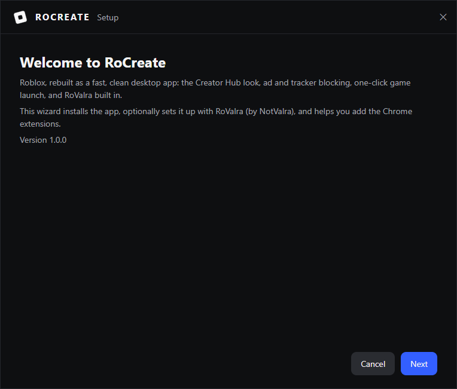 | 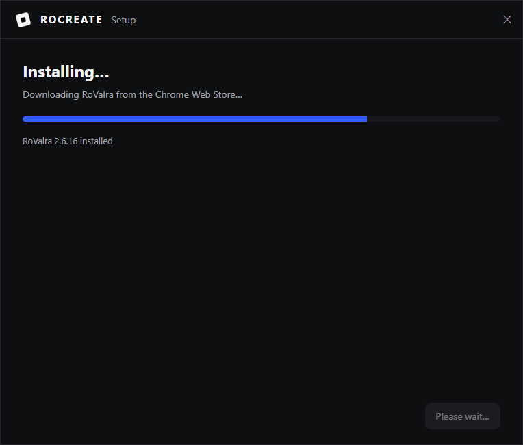 |
| Setup | Installing, with RoValra downloaded for you |
| 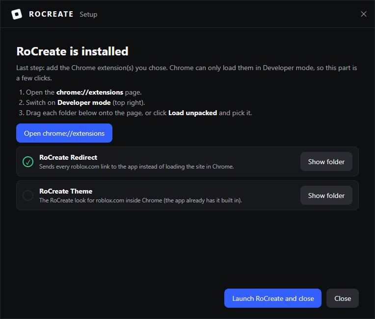 |  |
| Adding the Chrome extensions | Choosing what to install |

### Privacy and safety

- RoCreate has no account, server or telemetry. You sign in to Roblox exactly as you would in a
  browser, and that login stays in a local profile at `%LOCALAPPDATA%\RoCreate\profile`
  (`~/Library/Application Support/RoCreate/profile` on macOS). It is never in the install folder
  or in this repository.
- The app talks to Roblox, and to the Chrome Web Store when it downloads or updates RoValra.
  That is all.
- The blocklist only drops third-party analytics and Roblox's own telemetry hosts.
- `rocreate://` links and the local socket only accept `https` links on `roblox.com`.
- Uninstalling (`RoCreate.exe --uninstall` or Windows Settings → Apps) removes the app, its
  shortcuts and its registry entries. Tick *Also delete my data* to remove the login profile too.
  On macOS, drag RoCreate.app to the Trash; delete `~/Library/Application Support/RoCreate` to
  remove the login profile too.

RoCreate isn't affiliated with Roblox Corporation or with RoValra. See [NOTICE.md](NOTICE.md).

### How it works

- **The window** is [pywebview](https://pywebview.flowrl.com) on Windows' own WebView2. The
  theme is injected before the page runs, so there is no flash of the unstyled site.
- **The theme** works by redefining Roblox's own design tokens (the Foundation CSS variables),
  plus explicit rules for the older top bar. The same `theme.css` powers the Chrome extension.
- **RoValra** is a Manifest V3 Chrome extension, which WebView2 can load unpacked. It is
  downloaded from the Chrome Web Store into your data folder, never bundled here, so it stays
  under its own GPL-3.0 licence and updates from its real source.
- **macOS** uses Qt WebEngine instead. It loads RoValra too, with two small fixes RoCreate applies
  to your downloaded copy: stubs for the two extension APIs Qt doesn't have (`permissions` and
  `contextMenus`, so RoValra's background worker starts), and its images and stylesheets are
  served to the page over a `rocreate-ext://` scheme, because Qt won't let roblox.com load them
  from the extension directly. Play opens the place straight in the Roblox app with a
  `roblox://experiences/start` link (no website "joining" step), and when you leave the game
  RoCreate reads that from Roblox's own log, hides the Roblox app (it stays running, so the next
  launch is instant) and comes back to the front. Nothing touches the Roblox client itself.
- **Opening links:** the redirect extension rewrites `roblox.com` navigations to
  `rocreate://open?u=…`; the app registers that protocol per user, forwards the link to an
  already-running window over a local socket, and the Chrome tab closes itself once the app has
  confirmed it got the link.

### Linux

Not supported yet. The two Chrome extensions are plain Manifest V3 and work in Chrome on any
system.

### Building from source

Needs Python 3.12+ on Windows or macOS.

```sh
pip install -r requirements.txt
python app/app.py              # run from source
python installer/build.py      # build dist/RoCreate-Setup.exe (Windows) or dist/RoCreate.dmg (macOS)
```

The DMG is built for the Mac's own architecture (an Intel build also runs on Apple silicon
through Rosetta).

```
app/                   the desktop app and the setup wizard (wizard_ui/)
extensions/theme/      Chrome extension: the RoCreate theme (also injected by the app)
extensions/redirect/   Chrome extension: roblox.com links → rocreate:// → the app
installer/             build script that packs the app and wizard into RoCreate-Setup.exe
docs/                  banner and screenshots
```

</details>

## Credits

[RoValra](https://github.com/NotValra/RoValra) by NotValra. Thanks to the
[pywebview](https://github.com/r0x0r/pywebview) and
[pythonnet](https://github.com/pythonnet/pythonnet) projects.

## License

MIT, see [LICENSE](LICENSE). Third-party notices are in [NOTICE.md](NOTICE.md).
